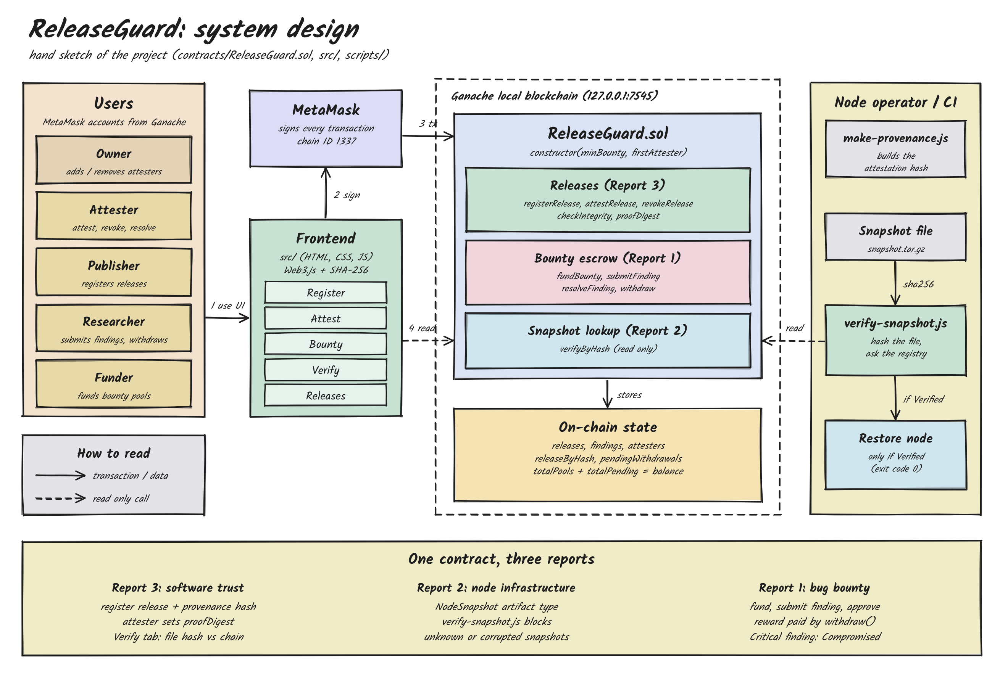

# ReleaseGuard

A blockchain trust registry for software releases, blockchain-node snapshots and bug bounties.
Built with Solidity, Truffle, Ganache, MetaMask, Web3.js and a React (Vite) frontend.




## What it does

| Part | What happens | Report it covers |
|---|---|---|
| **Releases** | A publisher registers a release: name, version, SHA-256 of the file, source commit and the hash of its provenance (build record). An attester marks it **Verified** and stores a `proofDigest`. Anyone can upload a file to check it against the on-chain hash. | Report 3 (software trust) |
| **Node snapshots** | A snapshot is registered the same way with type `NodeSnapshot`. `scripts/verify-snapshot.js` hashes the snapshot file and refuses the restore unless it is a Verified snapshot in the registry. | Report 2 (node infrastructure) |
| **Bug bounty** | Anyone can fund a release's bounty pool. A researcher submits a finding (hash of the report + severity). An attester approves or rejects it. An approved reward is credited to the researcher, who withdraws it. An approved Critical finding marks the release **Compromised**. | Report 1 (bug bounty / DevOps) |

Authenticity is checked by **hash comparison**, not by a digital signature. Only the hash of the provenance file
is stored on-chain, so signature checks (e.g. Sigstore) stay off-chain.

## Frontend (React + Vite)

The interface follows the project's `design.md`: a warm peach canvas, large Bebas Neue display type in violet, black pill buttons, flat pastel cards (no shadows), badge pills for statuses, a toast area at the bottom left and a small dots widget on the right edge.

- **Wallet:** connects through MetaMask and Web3.js. It reconnects silently on reload and follows account and network changes.
- **Role-aware:** the header shows your role (Owner, Attester or User), and attester-only actions are disabled for other accounts.
- **Live data:** releases, findings, balances and bounty pools refresh every 5 seconds and after every transaction.
- **Releases tab:** click a row to see the source commit, attestation hash and proof digest.
- **Errors:** contract revert reasons (for example "publisher cannot report own release") are shown in a toast.
- **Fonts:** headlines use MetaMask's hero face **Grotzec Cond Bold** when it is available, otherwise **Bebas Neue**. Grotzec is a commercial font (Feliciano Type), so it is not bundled. To use it, install a licensed copy on your computer, or copy `GrotzecCond-Bold.woff2` (or `.otf`) into `web/public/fonts/` (see the README.txt there). Body text uses DM Sans and Inter.
- **Responsive:** the layout adapts from phones to wide desktops (four stat cards, then two, then one; forms stack; tabs scroll sideways on small screens).
- **Legacy version:** the earlier plain HTML + JavaScript page is kept in `legacy/` and runs with `npm run serve:legacy` (open http://localhost:3000/legacy/index.html).

## Smart contract: `contracts/ReleaseGuard.sol`

- **Constructor:** `constructor(uint256 _minBounty, address _firstAttester)` sets the owner (also an attester), an optional second attester and the minimum bounty.
- **Transaction functions:** `registerRelease`, `attestRelease`, `revokeRelease`, `fundBounty` (payable), `submitFinding`, `resolveFinding`, `withdraw`, `addAttester`, `removeAttester`.
- **View functions:** `checkIntegrity`, `verifyByHash`, `getRelease`, `getFinding`, `isAttester`.
- **Safety rules:** pull payments (rewards are claimed with `withdraw`), state is updated before ETH is sent, reward cannot exceed the release's pool, a publisher cannot report their own release, a reporter cannot resolve their own finding, duplicate artifact hashes are rejected.
- **Invariant:** `address(this).balance >= totalPools + totalPending` (equal unless ETH is force-sent with `selfdestruct`). Test T23 checks it after every step of 60 random operations.

## Roles

| Role | Who | Can do |
|---|---|---|
| Owner | Account that deploys | Add or remove attesters |
| Attester | Owner and any added account | Attest and revoke releases, resolve findings |
| Publisher | Anyone | Register releases |
| Funder | Anyone | Fund a release's bounty |
| Researcher | Anyone except the release's publisher | Submit findings, withdraw rewards |

## Quick start (one command)

1. Install Node.js 18+ and the MetaMask browser extension (once).
2. Double-click **`start.bat`** (or **`start-demo.bat`** to also load demo data). On macOS or Linux run `npm start` (or `npm run start:demo`).

The launcher installs packages on the first run, starts Ganache, compiles and deploys the contract, runs the 23 tests, starts the website and opens it in your browser. Press **Ctrl+C** (or close the window) to stop everything.

Do this once in MetaMask (details in the Setup section below): add the network **Ganache Local** (RPC `http://127.0.0.1:7545`, chain ID `1337`, symbol `ETH`), import Ganache's private keys (0) to (4), and in the connected-site bar make sure the network is **Ganache Local**. The keys are the same every time the launcher runs.

Each launch starts a fresh blockchain, so earlier releases disappear and the contract is redeployed automatically. If MetaMask transactions fail after a restart, go to Settings, Advanced, **Clear activity tab data**.

## Setup (Windows, macOS or Linux)

Requirements: Node.js 18+, the MetaMask browser extension, internet access for the first compile (Truffle downloads solc 0.8.19).

```bash
npm install
```

**Terminal 1: start the local blockchain**

```bash
npm run ganache
```

It prints 10 accounts with private keys (they are the same every time because of `--wallet.deterministic`).

**Terminal 2: compile, deploy, test**

```bash
npm run compile
npm run migrate        # deploys ReleaseGuard (minBounty 0.1 ETH, attester = account 1)
npm test               # 23 tests
```

**Connect MetaMask to Ganache**

1. MetaMask, then network list, then **Add network manually**.
2. Network name `Ganache Local`, RPC URL `http://127.0.0.1:7545`, chain ID `1337`, symbol `ETH`.
3. Import accounts using the private keys printed by Ganache (account 0 to 4):

| Ganache account | Use as |
|---|---|
| 0 | Owner |
| 1 | Attester |
| 2 | Publisher |
| 3 | Researcher |
| 4 | Funder |

**Run the frontend** (React + Vite dev server; it always serves the freshly compiled contract, so there are no stale-cache problems)

```bash
npm run serve
```

Open http://localhost:3000/ . The page reconnects to MetaMask automatically if the site is already permitted. Otherwise click **Connect wallet**.

## Live demo kit

`npm run demofiles` (the launcher runs it automatically) creates the **demo-files** folder with everything needed for a live demo: real `.zip` releases with provenance JSON files, a library, **tampered** copies, node snapshots with a **corrupted** copy, and three bounty report files. None of them is registered by the seed data, so each one can be registered once per run.

Open `demo-files/DEMO-GUIDE.md` for the exact values to type and a ready-made demo script.

If you see **"This exact file is already registered"**: a file's fingerprint depends on its content, not its name, so copies and renamed files count as the same file. Pick a different file from `demo-files` (the seeded demo data already uses `sample/app-v1.0.0.zip` and `sample/snapshot-demo.tar.gz`).

## Demo data and scripts

```bash
npm run samples        # creates sample/app-v1.0.0.zip, a tampered copy, a demo snapshot and a corrupted copy
npm run provenance     # writes sample/app-v1.0.0.zip.provenance.json and prints artifactHash and attestationHash
npm run seed           # optional: registers and attests two demo releases and funds 1 ETH on release #1
npm run verify         # runs verify-snapshot.js on the good snapshot
node scripts/verify-snapshot.js sample/snapshot-demo-corrupted.tar.gz   # blocked
```

`verify-snapshot.js` exits with code 0 only if the snapshot is a **Verified NodeSnapshot**, so it can be used as an init step:

```bash
node scripts/verify-snapshot.js /data/snapshot.tar.gz && ./restore.sh
```

If your Ganache runs on another port, set `RPC_URL`, for example `RPC_URL=http://127.0.0.1:8545`.

## Demo script (about 8 minutes)

| Step | Account | Action | Expected |
|---|---|---|---|
| 1 | Owner | Connect wallet | Header shows `Owner` |
| 2 | Publisher | Register tab: Binary, `app` 1.0.0, upload `sample/app-v1.0.0.zip` and its provenance JSON | Release in table, status Pending |
| 3 | Publisher | Register `node-snapshot` as NodeSnapshot with `sample/snapshot-demo.tar.gz` | Second release, Pending |
| 4 | Attester | Attest tab: attest both releases | Both Verified |
| 5 | Anyone | Verify tab: original zip with its release ID | INTEGRITY VERIFIED |
| 6 | Anyone | Verify tab: `app-v1.0.0-tampered.zip` with the same ID | INTEGRITY FAILED |
| 7 | Terminal | `npm run verify`, then verify the corrupted snapshot | RESTORE ALLOWED, then BLOCKED |
| 8 | Funder | Bounty tab: fund release 1 with 1 ETH | Pool shows 1 ETH |
| 9 | Researcher | Submit a Critical finding on release 1 | Finding Open |
| 10 | Attester | Resolve the finding: Approve, reward 0.5 ETH | Release 1 becomes Compromised |
| 11 | Researcher | Withdraw | Wallet balance rises by 0.5 ETH |
| 12 | Terminal | `npm test` | All 23 tests pass |

If you ran `npm run seed`, skip steps 2 to 4 and 8 (data already exists).

## Tests

`test/ReleaseGuard.test.js`: T01 to T23 cover the constructor and roles, registration (including duplicates), attestation, funding, findings, approval and rejection, Critical findings, withdrawal, integrity checks, hash lookup, and the balance invariant over random operations.

## Limitations

- Attesters are trusted. The contract records their decisions but cannot prove a build is honest.
- The registry proves a hash was recorded, not that the code is free of bugs.
- Formal verification is approximated by the invariant test and a stored `proofDigest`. There is no SMT proof.
- Sigstore or SLSA signatures are not verified on-chain.
- It runs on a local Ganache chain. A public testnet would need deployment keys and gas funds.
- Truffle and Ganache are no longer actively maintained, but they work for this project. Hardhat is the maintained alternative.

## Folder structure

```
contracts/ReleaseGuard.sol
migrations/1_initial_migration.js, 2_deploy_release_guard.js
test/ReleaseGuard.test.js
scripts/common.js, make-samples.js, make-provenance.js, verify-snapshot.js, seed-demo.js
web/                      React + Vite frontend (index.html, src/App.jsx, src/components/, src/styles.css)
vite.config.mjs           Vite config (also serves build/contracts/ReleaseGuard.json fresh on every request)
legacy/                   the earlier plain HTML + JS frontend (kept as a fallback: npm run serve:legacy)
sample/   small sample files used by the seed script
demo-files/   live-demo kit (zips, tampered copies, snapshots, bounty reports, DEMO-GUIDE.md)
truffle-config.js, package.json
```
